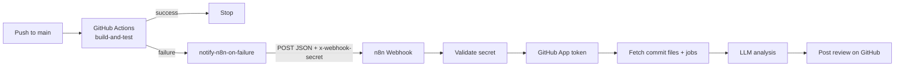

# AI GitHub Code Reviewer

**Event-driven CI automation that turns a failed GitHub Actions run into LLM-assisted code-review feedback via n8n.**

> **Honesty first:** This repository demonstrates a real GitHub Actions → webhook → n8n → LLM design that previously worked end-to-end. The original n8n workflow, LLM prompt, and hosted environment were **not persisted** and are **not** recoverable from a fresh clone alone. What you get here is the surviving Actions integration, GitHub App helpers, a **reconstructed** n8n workflow, and setup docs precise enough to restore the system manually.

---

## Overview

Flaky or broken pushes often leave developers staring at raw CI logs. This project explores a practical alternative:

- Detect CI failure in GitHub Actions
- Hand off run metadata to an orchestration layer (n8n) over a secured webhook
- Let n8n gather changed files / job context from the GitHub API
- Ask an LLM for a structured review (scores, issues, suggested fixes)
- Post that review back into GitHub as developer-visible feedback

The small Node.js app in the repo is a **CI fixture**, not the product. It is deliberately broken so the failure path can be exercised.

---

## Key Features

- **CI-triggered analysis** — review starts only when `build-and-test` fails
- **Secured webhook handoff** — shared secret via `x-webhook-secret`
- **Context enrichment outside Actions** — n8n pulls commit files / jobs (Actions payload stays small)
- **GitHub App authentication helpers** — JWT + installation-token scripts for API access
- **LLM-oriented review shape** — scores, issues, and fixes (illustrative sample included)
- **Reconstructed n8n workflow** — importable starting point, clearly labeled as non-original

---

## Architecture



**Boundary that matters:** GitHub Actions does **not** upload logs or diffs. It sends identifiers (`run_id`, `repo`, `commit`, …). Enrichment and LLM calls happen in n8n.

---

## Workflow

1. Developer pushes to `main` (fixture currently fails `npm test` / `npm run build` on purpose).
2. Actions job `build-and-test` runs on `ubuntu-latest` with Node 20.
3. On failure, job `notify-n8n-on-failure` validates secrets and `POST`s JSON to n8n.
4. n8n checks `x-webhook-secret`, authenticates to GitHub as an App installation.
5. n8n loads changed files for the commit and workflow job outcomes for the run.
6. An LLM produces a structured review markdown.
7. n8n posts the review back (commit comment / PR / issue — exact original channel unverified).

---

## Technology Stack

| Technology | Actual role in this project |
|---|---|
| **GitHub Actions** | CI runner + failure detector + webhook client |
| **Node.js 20 + Express** | Minimal smoke-test fixture that can fail CI |
| **n8n** | Workflow orchestration, HTTP, secret checks, LLM node host |
| **GitHub App** | Machine auth to read contents and write review feedback |
| **LLM provider** | Analysis engine — **provider not recovered**; configure in n8n |
| **Docker Compose** | Optional local n8n for reconstruction / demos |
| **Python (PyJWT)** | Local GitHub App JWT minting helper |

---

## Project Structure

```text
.
├── .github/workflows/main.yml      # CI + failure webhook (surviving core)
├── index.js / test.js              # Intentionally failing CI fixtures
├── package.json                    # Fixture dependencies
├── docker-compose.yml              # Local n8n
├── .env.example                    # Safe configuration template
├── scripts/
│   ├── generate_github_app_jwt.py  # Preferred JWT helper
│   ├── generate_github_app_jwt.ps1 # PowerShell 7+ alternative
│   └── mint_installation_token.sh  # Installation access token helper
├── n8n/
│   ├── README.md
│   └── workflow.reconstructed.json # Importable reconstruction (NOT original)
├── docs/
│   ├── AUDIT.md
│   ├── reconstruction-guide.md
│   ├── payloads/                   # Example + confirmed webhook fields
│   └── examples/                   # Illustrative review sample
├── experiments/                    # Unofficial Gemini scrape (not production)
└── secrets/                        # Local PEM mount point (gitignored contents)
```

---

## Prerequisites

- GitHub repository with Actions enabled
- Node.js **20+** (workflow uses 20; local engines field matches)
- n8n (Cloud **or** Docker via Compose)
- A **GitHub App** installed on the target repo with at least:
  - `contents: read`
  - `metadata: read`
  - `pull_requests: write`
  - `issues: write`
  - `statuses: write` *(observed on the original app install)*
- An LLM API key for whichever provider you wire into n8n
- Optional: Python 3 + `pip install -r requirements-dev.txt` for JWT scripts
- Optional: Docker Desktop for local n8n

---

## Setup Instructions (fresh clone)

```bash
git clone <your-fork-or-repo-url>
cd <repo>
cp .env.example .env
# Edit .env with placeholders only — real secrets stay out of git

npm install                 # fixture deps
# Fixtures are designed to FAIL until you comment out INTENTIONAL FAILURE lines
```

Place your GitHub App private key at:

```text
secrets/github-app-private-key.pem
```

(or another path pointed to by `GITHUB_APP_PRIVATE_KEY_PATH`).

---

## GitHub Configuration

### Actions secrets

| Secret | Required | Description |
|---|---|---|
| `N8N_WEBHOOK_URL` | Yes | Full n8n webhook URL (production URL after workflow is active) |
| `N8N_WEBHOOK_SECRET` | Yes | Shared secret; must match n8n `WEBHOOK_SHARED_SECRET` |

Set under **Settings → Secrets and variables → Actions**.

### Permissions / App install

1. Create or reuse a GitHub App (original project used an app named roughly “ci-cd-reviewer”).
2. Install it on the repository (or account) you want reviewed.
3. Note **App ID**, **Client ID**, **Installation ID**, and download the **private key**.
4. Do **not** commit the PEM. Use `scripts/` helpers to mint JWTs / installation tokens for n8n setup.

### Workflow file

`.github/workflows/main.yml` is the source of truth. It:

- Runs on `push` to `main`
- Fails closed with a clear error if webhook secrets are missing
- Sends confirmed fields plus a few additive helpers (`event_name`, `workflow`, `run_url`)

---

## n8n Setup

### Option A — Local Docker

```bash
cp .env.example .env   # set N8N_BASIC_AUTH_PASSWORD, WEBHOOK_SHARED_SECRET, etc.
docker compose up -d
# UI: http://localhost:5678
```

### Option B — n8n Cloud

Create a workspace, then import the same workflow JSON.

### Import reconstructed workflow

1. In n8n: **Import from File** → `n8n/workflow.reconstructed.json`
2. Configure nodes labeled **CONFIGURE** (GitHub token + LLM)
3. Set env `WEBHOOK_SHARED_SECRET` to the same value as Actions `N8N_WEBHOOK_SECRET`
4. Activate → copy **Production** webhook URL into `N8N_WEBHOOK_URL`

Details, assumptions, and a hand-built alternative: [`n8n/README.md`](n8n/README.md), [`docs/reconstruction-guide.md`](docs/reconstruction-guide.md).

### LLM credentials

Configure an **official** provider credential in n8n (OpenAI, Google AI, Anthropic, …).  
`experiments/gemini_unofficial.py` is an exploratory scraper and is **not** a supported production path.

---

## Execution

### Trigger via CI (intended path)

1. Keep intentional fixture failures **or** push any breaking change to `main`.
2. Watch Actions: `build-and-test` fails → `notify-n8n-on-failure` runs.
3. Confirm n8n execution log and any GitHub comment/review created by your workflow.

### Trigger locally (n8n only)

```bash
curl -X POST "http://localhost:5678/webhook/ci-failure-review" \
  -H "Content-Type: application/json" \
  -H "x-webhook-secret: $N8N_WEBHOOK_SECRET" \
  -d @docs/payloads/webhook-request.example.json
```

### Green fixture (optional)

Comment out the `INTENTIONAL FAILURE` lines in `index.js` and `test.js`, then:

```bash
npm test
npm run build
```

---

## Troubleshooting

| Symptom | Likely cause | What to check |
|---|---|---|
| Notify job errors “Missing secret …” | Secrets not set | Repo Actions secrets names must match exactly |
| `curl` fails / 404 from n8n | Wrong URL or inactive workflow | Use **Production** URL after Activate; path must match |
| `Invalid x-webhook-secret` | Secret mismatch | Actions secret ↔ n8n `WEBHOOK_SHARED_SECRET` |
| GitHub API `401` | Bad JWT / wrong token type | App JWT for `/app/*`; installation token for repo APIs |
| GitHub API `404` on installations | Wrong installation ID or App not installed | Re-list `/app/installations` with App JWT |
| LLM node empty / stub text | Stub not replaced | Swap `CONFIGURE LLM Call (stub)` for a real LLM node |
| Windows JWT script fails on `ImportFromPem` | Windows PowerShell 5.1 | Use `pwsh` 7+ or the Python script |
| CI never calls n8n | Build actually succeeded | Failure job only runs when `build-and-test` fails |

---

## Current Limitations

**Implemented in-repo**

- GitHub Actions failure → webhook client
- Example / confirmed payload contracts
- GitHub App JWT + installation-token helpers
- Local n8n Compose stack
- Reconstructed (not original) n8n workflow JSON
- Honest documentation and audit trail

**Previously worked, requires missing infrastructure**

- Live n8n instance with the original graph
- Original LLM provider binding and prompt text
- Exact GitHub feedback channel configuration
- Repository-specific App installation + secrets

**Runnable from a fresh clone today**

- Install Node deps
- Observe intentional fixture failures
- Validate Actions YAML structure
- Start local n8n via Docker Compose
- Import the reconstructed workflow and continue manual configuration

**Not plug-and-play**

- End-to-end review posts will not appear until you supply n8n, App credentials, LLM credentials, and Actions secrets
- No claim of verified post-salvage production success

See [`docs/AUDIT.md`](docs/AUDIT.md) for the file-by-file salvage baseline.

---

## License

MIT (see `package.json`). Add a full `LICENSE` file if you publish under a specific copyright holder.
